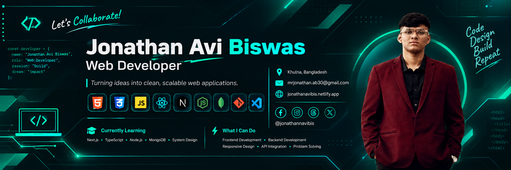

  

# 👨‍💻 Jonathan Avi Biswas
### Web Developer | React & Next.js Enthusiast

<!-- Dynamic Typing Animation -->

  
  

<!-- Social & Contact Badges -->

  
  
  
  
  
  

---

## 🌟 About Me

Hello! 👋 I'm **Jonathan Avi Biswas**, a dedicated and passionate **Web Developer** based in **Khulna, Bangladesh 🇧🇩**. I specialize in creating responsive, accessible, and high-performance web applications using modern web technologies. 

With a strong eye for clean UI/UX and structured architecture, I enjoy transforming ideas into functional, interactive digital solutions.

- 🔭 **Current Focus:** Building scalable web applications with **Next.js 14**, **TypeScript**, & **Tailwind CSS**
- 🚀 **Projects:** Developing workout tracking, book management systems, and e-commerce platforms
- 🌱 **Learning & Exploring:** Advanced Backend Architecture, Cloud Integrations & System Design
- 💬 **Ask me about:** React, Next.js, TypeScript, JavaScript (ES6+), Responsive UI Design
- 📫 **Contact Me:** [mrjonathan.ab30@gmail.com](mailto:mrjonathan.ab30@gmail.com)
- ⚡ **Fun Fact:** I love sleek dark-mode designs, clean folder structures, and high-performance code!

---

## 🛠️ Tech Stack & Skills

### 💻 Languages

  
  
  
  

### ⚛️ Frontend Frameworks & Libraries

  
  
  

### 🟢 Backend & Runtime

  
  

### 🧰 Tools & Platforms

  
  
  
  
  
  
  

---

## 🚀 Featured Projects

| Project | Description | Tech Stack | Links |
| :--- | :--- | :--- | :--- |
| **🏋️ FitLog** | A sleek, dark-themed workout tracking web application | Next.js 14, TypeScript, Tailwind CSS | [Repository](https://github.com/jonathanavibis/fitlog-workout-tracker) |
| **📚 FavBook** | Modern book management platform with full catalog & reviews | React, TypeScript, Node.js, Express | [Client](https://github.com/jonathanavibis/favbook-a08) • [Server](https://github.com/jonathanavibis/favbook-server-a08) |
| **🛒 Bazar Dor Web** | Real-time Bangladeshi market commodity price tracker | JavaScript, Responsive UI, Web APIs | [Repository](https://github.com/jonathanavibis/bazar-dor-web) |
| **🛠️ Dev Stack Builder** | Interactive tool for developers to explore and build tech stacks | React, JavaScript, Modern CSS | [Repository](https://github.com/jonathanavibis/dev-stack-builder) |
| **🌐 Portfolio Website** | Personal developer portfolio showcasing projects and skills | Next.js, React, Tailwind CSS | [Live Demo](https://jonathanavibis.vercel.app/) • [Code](https://github.com/jonathanavibis/jonathanavibis-portfolio) |

---

## 📊 GitHub Analytics

  <table border="0">
    <tr>
      <td width="50%">
        
      </td>
      <td width="50%">
        
      </td>
    </tr>
  </table>

   

  

---

## 📬 Let's Connect

  I am always open to discussing new projects, creative ideas, or opportunities to be part of your vision!

  
  

  Designed with ❤️ by <strong>Jonathan Avi Biswas</strong> • Khulna, Bangladesh

